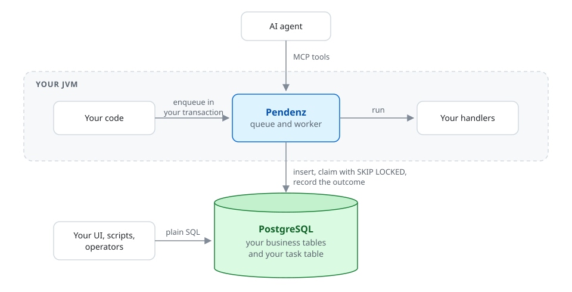

# Pendenz

[](https://github.com/pendenzlib/pendenz/actions/workflows/ci.yml)
[](https://central.sonatype.com/namespace/io.github.pendenzlib)
[](LICENSE)

A task queue for the JVM whose tasks live in tables **you** own.

> *Pendenz* (Swiss German): an open item, something still to be done.

Pendenz is a Kotlin library, usable from Java, for background work in systems
that already have a relational database and their own user interface. Tasks
are ordinary rows in your schema. You can see them, restart them and complete
them with plain SQL, join them to your business tables, and build your own
screens on top. There is no server, no dashboard you did not ask for, and no
binary blob between you and your data.

> [!NOTE]
> 0.5.0 is the first release: everything on the roadmap through 0.5,
> tested against PostgreSQL. Before 1.0 a minor version may change the
> API; the [changelog](CHANGELOG.md) names every break.

## At a glance

<picture>
  <source media="(prefers-color-scheme: dark)" srcset="docs/images/overview-dark.svg">
  
</picture>

## Try it

The billing demo needs nothing but a JDK 17; it starts an embedded
PostgreSQL:

```bash
git clone https://github.com/pendenzlib/pendenz.git
cd pendenz
./gradlew :examples:demo:run
```

In your own code, a task type, its table, a queue and a worker:

```kotlin
@Serializable
data class SendInvoice(val invoiceId: Long, val customer: String)

val sendInvoice = TaskType.json<SendInvoice>("send-invoice")
val table = TaskTable(name = "billing_task")
println(PostgresDdl.createTable(table, sendInvoice))     // into your migration

val pendenz = Pendenz.create(table) {
    dataSource(dataSource)
    register(sendInvoice) { _, invoice -> mail.send(invoice) }
}
val applicationScope = CoroutineScope(SupervisorJob() + Dispatchers.Default)
pendenz.startWorker(applicationScope)                     // cancel the scope to stop the worker

connection.autoCommit = false                             // the task commits with the business change
invoices.markBilled(connection, 42)
pendenz.enqueue(connection, sendInvoice, SendInvoice(42, "Globex"))
connection.commit()
```

The [guide](docs/guide.md) takes it from there; Java and Spring have
pages of their own.

## Installation

From Maven Central. The core is one dependency, and every module in the
[table below](#modules) is another next to it, in the same version:

```kotlin
dependencies {
    implementation("io.github.pendenzlib:pendenz-core:0.5.0")
    // implementation("io.github.pendenzlib:pendenz-spring-boot-starter:0.5.0")
}
```

```xml
<dependency>
    <groupId>io.github.pendenzlib</groupId>
    <artifactId>pendenz-core</artifactId>
    <version>0.5.0</version>
</dependency>
```

Requires Java 17 or later. Kotlin applications need kotlinx-coroutines
1.10.2 and kotlinx-serialization 1.9.0 or later; Spring Boot 4 brings
both.

## Why

Existing JVM schedulers hide their work: Quartz needs eleven tables of
serialized blobs, JobRunr ships its own dashboard and stores jobs as JSON,
db-scheduler uses one fixed table with a binary payload. Teams that must show
progress and failures in their own UI, restart tasks with SQL, or process a
whole dataset as one batch end up writing the queue themselves. Pendenz is
that queue, written once.

## Principles

1. **Flexible, with good defaults.** Every behaviour is replaceable: claim
   strategy, retry policy, serialization, clock, hooks. Every one has a sane
   default, so the common case needs no decisions.
2. **The schema is yours.** Pendenz knows concepts (status, attempts, run
   time), not table or column names. You map them onto your table and add
   whatever columns, foreign keys and indexes you like.
3. **SQL is a supported interface.** Status transitions are documented and
   enforced. DDL, views and SQL functions are generated from your mapping.
4. **Integration, not takeover.** No process of its own, no framework in the
   core, no migrations of its own. Enqueue inside your transaction.
5. **Small core, modules on demand.**
6. **Leaving costs nothing.** Tasks are rows, handlers are functions. Remove
   the library and everything stays readable.
7. **Outside callers only use registered task types.** A UI, another system
   or an AI agent picks a task type the developer registered and supplies a
   payload that is validated. What happens next is decided by your handler.
8. **The schema is a versioned public API.** Status names, minimum columns
   and generated views are stable from 1.0 on.
9. **Testable without infrastructure.** A synchronous in-memory mode runs
   handlers directly.

## What it does

A task is a row, and its `status` column holds one of ten states. The
library enforces the legal transitions, and so do the generated SQL
functions:

| Status | Who acts next | Meaning |
|---|---|---|
| `PENDING` | Pendenz | Due, waiting to be claimed |
| `SCHEDULED` | Pendenz | Run time in the future |
| `RUNNING` | Pendenz | Claimed, heartbeat running |
| `RETRY_PENDING` | Pendenz | Failed, attempts left, backoff running |
| `SUCCEEDED` | nobody | Done |
| `CANCELLED` | nobody | Will never run |
| `FAILED` | a human | Attempts exhausted |
| `REJECTED` | a human | Result refused by validation |
| `QUARANTINED` | a human | Set aside with a reason |
| `AWAITING_APPROVAL` | a human | Task type requires approval |

Around that:

- **Your schema.** Payload in one JSON column or in typed columns SQL can
  join; `bigint` or `uuid` ids; generated DDL for your migration tool.
  [Guide](docs/guide.md)
- **Your transaction.** Enqueue with your connection, or inside a Spring
  `@Transactional` method; the task commits or rolls back with the
  business change. [Guide](docs/guide.md#enqueue-in-your-transaction),
  [Spring](docs/spring.md)
- **Reliable workers.** Claim with `SKIP LOCKED`, heartbeats, lock
  timeouts, retry with backoff, execution timeouts, graceful shutdown,
  optimistic versions so an operator's SQL always wins.
  [Concepts](docs/concepts.md#workers-and-claiming)
- **Operating with SQL.** Generated views for failures, stuck tasks and
  everything waiting for a person; functions to restart, complete,
  quarantine and cancel. [SQL recipes](docs/sql-recipes.md)
- **Whole datasets.** Cycles from a SQL query, paused, resumed and
  cancelled as one; fair turns across lanes, priorities, batch claims,
  concurrency limits per resource. [Concepts](docs/concepts.md#cycles)
- **Control.** Chained follow-ups in the outcome's transaction, validated
  results with provenance, previews, human approval, permissions.
  [Concepts](docs/concepts.md#approval-and-permissions)
- **Recurring tasks.** Schedules with intervals, daily times or cron, one
  occurrence ahead as an ordinary row, without a leader among instances.
  [Concepts](docs/concepts.md#recurring-tasks)
- **Agents.** Registered task types as MCP tools; what an agent creates
  can wait for a person. [Agents](docs/agents.md)
- **Observable and testable.** A listener for metrics and logs, a
  Micrometer module, an in-memory mode that runs handlers in the test.
  [Metrics](docs/metrics.md), [Guide](docs/guide.md#test-without-a-database)

## Modules

| Module | Artifact | Contents |
|---|---|---|
| `core` | `pendenz-core` | Schema mapping, status model, JDBC store, worker, builder. Depends on coroutines, kotlinx-serialization and SLF4J only. |
| `core-java` | `pendenz-core-java` | Java facade: blocking methods, `CompletableFuture`, handlers as plain methods. Its tests are written in Java. |
| `serialization-jackson` | `pendenz-serialization-jackson` | `PayloadCodec` and payload upgrades over Jackson 3, for teams without kotlinx-serialization. |
| `postgres-notify` | `pendenz-postgres-notify` | Wakes workers through `LISTEN`/`NOTIFY` instead of waiting for the poll interval. |
| `mcp` | `pendenz-mcp` | An MCP server over the task types you expose, so AI agents enqueue and follow tasks as tools. On the Java MCP SDK; opens no port of its own. |
| `micrometer` | `pendenz-micrometer` | Micrometer meters from the listener events, and gauges for the backlog per type and status with the age of the oldest due task. |
| `spring` | `pendenz-spring` | A connection provider that joins Spring transactions, checked against the transaction manager at construction. Spring Framework 6.2 and 7. |
| `spring-boot` | `pendenz-spring-boot-starter` | Spring Boot 4 auto-configuration: queue beans for Kotlin and Java, handlers as `TaskRegistration` beans, a worker in the lifecycle, startup checks, metrics and `LISTEN`/`NOTIFY` when their modules are present. |

Planned: adapters for Quarkus and Ktor.

## Examples

| Example | Shows | Run |
|---|---|---|
| [Billing demo](docs/examples.md#billing-demo) | Flyway, a flaky handler, an SQL restart, retention into an archive | `./gradlew :examples:demo:run` |
| [Spring shop](docs/examples.md#spring-shop) | Spring Boot starter, `@Transactional` enqueue, a handler bean, a retry | `./gradlew :examples:spring:bootRun` |
| [Helpdesk](docs/examples.md#helpdesk) | An AI agent acting through MCP tools, approval and refused results | `./gradlew :examples:helpdesk:run` |
| [Catalogue cycle](docs/examples.md#catalogue-cycle) | A cycle against a local model, a resource limit, operator SQL | `./gradlew :examples:catalog:run` |

The helpdesk and the catalogue need a local model, see
[`docs/examples.md`](docs/examples.md).

## Documentation

Everything else is in [`docs/`](docs): the guide, the concepts, SQL
recipes, Java, Spring, metrics, agents and the architecture decision
records.

## When not to use Pendenz

- You need replay of arbitrary program flow with branching: look at
  [DBOS](https://dbos.dev) or [Temporal](https://temporal.io).
- You start on a green field and are happy with a vendor dashboard: JobRunr
  or db-scheduler will get you going faster.

## Roadmap

The milestones 0.1 to 0.5 were built without separate releases; 0.5.0
contains them all. What changes from release to release is in the
[changelog](CHANGELOG.md).

| Milestone | Scope |
|---|---|
| 0.1 | Queue: schema mapping, status model, enqueue in your transaction, claim with `SKIP LOCKED`, retry with backoff, deferred tasks, idempotency keys, execution timeouts, retention, in-memory test mode, Java facade |
| 0.2 | Datasets: cycles from a SQL query, fair claiming, batch claim, per-resource concurrency, generated views and SQL functions |
| 0.3 | Control: human approval, permissions, chaining, result validation, provenance metadata, preview |
| 0.4 | Agents: MCP server exposing registered task types as tools |
| 0.5 | Examples and evidence: a demo service, an example agent, a catalogue cycle against a local model, Micrometer metrics, Spring Boot starter |

0.5.0 also contains recurring tasks (ADR 0033).

Next, when there is a need for them: adapters for Quarkus and Ktor,
further databases through the dialect seam.

## Development

```bash
./gradlew build
```

Needs a JDK 17 or 21 to run Gradle; tests run against a real PostgreSQL,
through Testcontainers when Docker is available and an embedded one
otherwise.
[`docs/development.md`](docs/development.md) has the details,
[`CLAUDE.md`](CLAUDE.md) the working rules and
[`CONTRIBUTING.md`](CONTRIBUTING.md) how to contribute.

## License

[Apache License 2.0](LICENSE)
